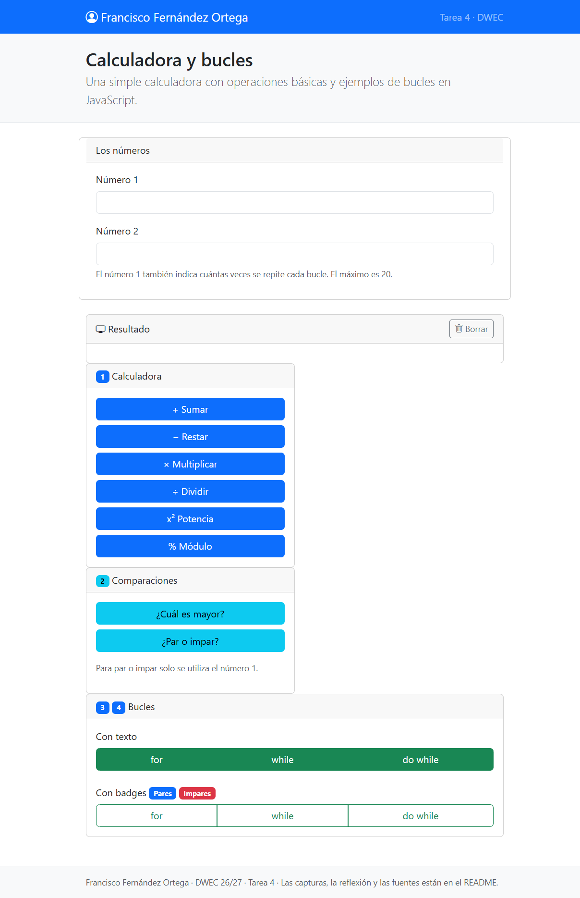
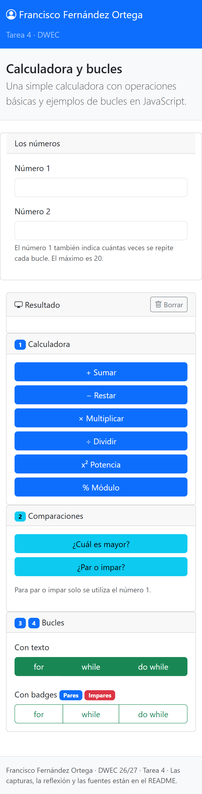
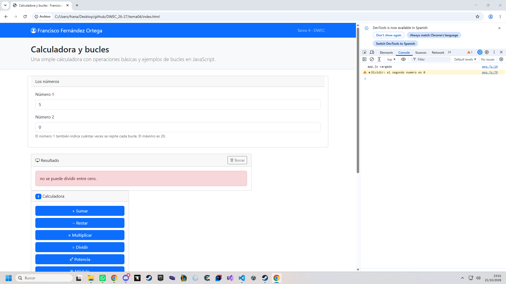
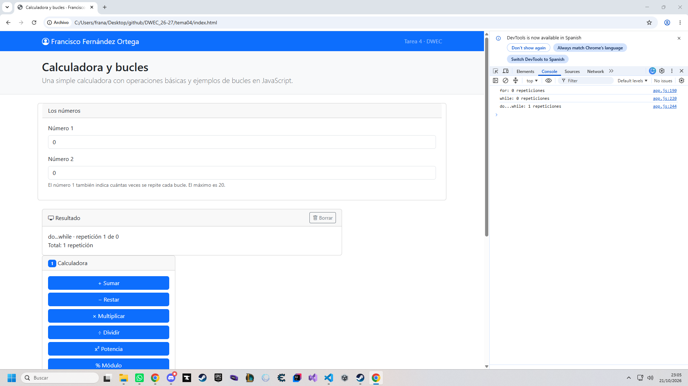
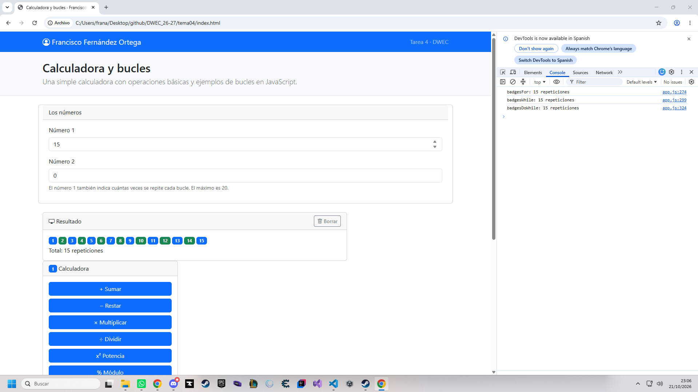

# Tarea 4 · Calculadora y bucles

**Autor:** [Francisco Fernández Ortega] · Desarrollo Web en Entorno Cliente (DWEC) · 2.º DAW · Curso 2026-27

> **Plantilla de la tarea 4.** Cómo usarla:
>
> 1. Copia esta carpeta en tu repositorio de DWEC y cámbiale el nombre a `tema04`.
> 2. `index.html` trae lo imprescindible para empezar: las dos casillas, la zona de resultado y el botón «Sumar». El resto de la página y su maquetación con Bootstrap los haces tú.
> 3. `js/app.js` trae `sumar()` hecha como modelo y las demás funciones con `TODO`.
> 4. `js/ayudas.js` no se toca: son las funciones que leen las casillas y escriben el resultado.
> 5. Sustituye las imágenes de `capturas/` por las tuyas, **con el mismo nombre**.
> 6. Todo lo que va entre [corchetes] es un hueco: cámbialo por lo tuyo. Al terminar, borra este aviso.

[Una o dos líneas: qué hay en esta carpeta y cómo se ve. Por ejemplo: abrir la carpeta en VS Code, pulsar **Go Live**, escribir dos números y pulsar los botones con la consola abierta (F12).]

## DESCRIPCION
En esta tarea he desarrollado una página web con una calculadora que permite realizar operaciones matemáticas básicas entre dos números. También he trabajado con los bucles for, while y do while de JavaScript para mostrar cómo se comportan con diferentes valores.

La página utiliza HTML, CSS, JavaScript y Bootstrap para organizar los elementos en tarjetas y adaptar el diseño a diferentes tamaños de pantalla.

## Capturas

### a) La página entera

Se muestra la página completa, con el nombre del autor en la barra de navegación y las tarjetas organizadas para facilitar el uso de la calculadora y los bucles.

### b) La página en el móvil

Se muestra la adaptación de la página a una pantalla de menor tamaño. Las tarjetas se reorganizan para facilitar la lectura y el uso desde dispositivos móviles.

### c) El error de dividir entre 0

Se comprueba el comportamiento de la calculadora cuando se intenta dividir entre cero. La consola del navegador permite observar el error generado.

### d) Los tres bucles con el número 0

Se compara el comportamiento de los tres tipos de bucles al introducir el número cero. El resultado depende de la condición y de cuándo se comprueba.

### e) Un bucle con badges

Se muestra un bucle que genera etiquetas o badges para representar los números, utilizando diferentes colores según la condición establecida en el código.

## Reflexión

Los bucles for, while y do while permiten repetir instrucciones, pero se diferencian en la forma de controlar las repeticiones. El bucle for es útil cuando conocemos el número de iteraciones que queremos realizar. El bucle while comprueba la condición antes de ejecutar las instrucciones, por lo que puede no ejecutarse ninguna vez. En cambio, do while ejecuta las instrucciones al menos una vez y después comprueba la condición. Al introducir el número cero, se puede observar esta diferencia: for y while pueden no ejecutarse, mientras que do while se ejecuta una vez si la condición se comprueba después del bloque. Esta práctica me ha ayudado a comprender mejor cómo funcionan los bucles y cómo elegir el más adecuado según el problema.

## Fuentes

-[MDN Web Docs](https://developer.mozilla.org/es/)
-[w3schools](https://www.w3schools.com/)
-[chatGpt](https://chatgpt.com/)

## Uso de IA

He utilizado ChatGPT como herramienta de apoyo para comprender y desarrollar partes de la tarea, resolver dudas sobre JavaScript y organizar el contenido del README. Después he revisado las explicaciones y adaptado el trabajo a los requisitos de la actividad.
