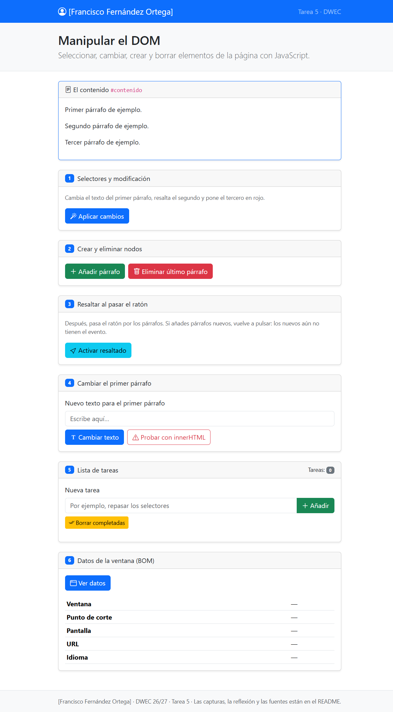
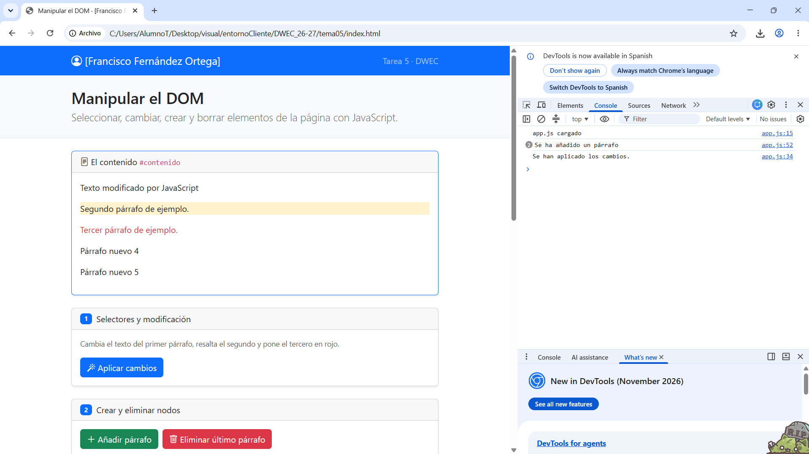
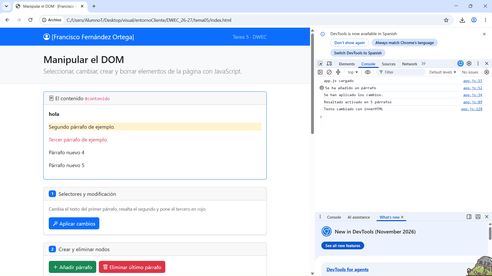
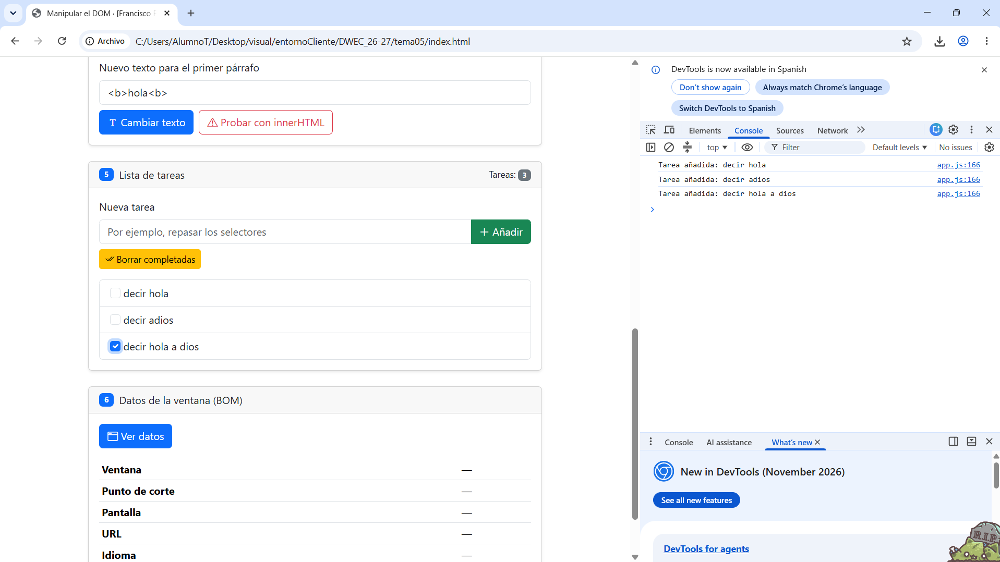
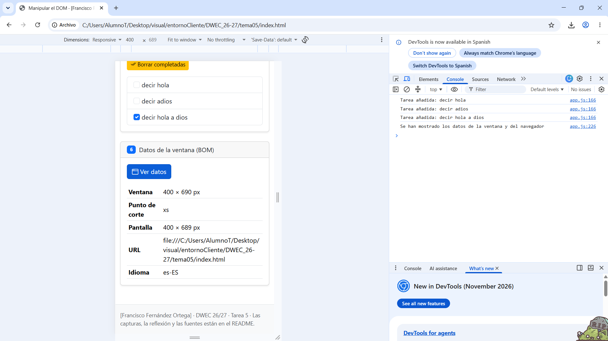

# Tarea 5 · Manipular el DOM

**Autor:** [Francisco Fernández Ortega] · Desarrollo Web en Entorno Cliente (DWEC) · 2.º DAW · Curso 2026-27

Descripción

En esta tarea he trabajado con JavaScript para manipular el DOM de una página web. He practicado cómo seleccionar elementos HTML, modificar sus textos y clases, crear y eliminar párrafos, añadir eventos al ratón, gestionar una lista de tareas y consultar información de la ventana y del navegador.

Para ejecutar la página, he abierto el proyecto en Visual Studio Code y he utilizado la extensión Live Server. También he comprobado el funcionamiento de los botones y los mensajes de la consola con las herramientas de desarrollador (F12).

## Capturas

### a) La página recién cargada

[Qué se ve: tu nombre y los tres párrafos de partida.]

### b) Ejercicios 1 y 2

[Qué ha cambiado en cada párrafo y qué selector has usado para cada uno.]

### c) Ejercicio 3: resaltado al pasar el ratón

[Qué párrafo está resaltado y qué pasa con los párrafos que añades después.]

### d) Ejercicio 4: `<b>hola</b>` con innerHTML

[Qué salía con «Cambiar texto» y qué sale con innerHTML.]

### e) Ejercicio 5: la lista de tareas

[Tres tareas, una marcada, antes de pulsar «Borrar completadas».]

### f) Ejercicio 6: los datos de la ventana en el móvil

[Qué punto de corte sale en el móvil y cuál en tu ordenador.]

## Reflexión

[De 5 a 8 líneas: ¿qué diferencia hay entre textContent e innerHTML y por qué no se debe meter en innerHTML lo que escribe el usuario? Pon como ejemplo lo que pasó con `<b>hola</b>`.]

## Fuentes

- [Título de la página](https://enlace-a-la-fuente)

## Uso de IA

[Si has usado IA: qué herramienta, para qué y qué hiciste después con su respuesta. Si no la has usado, borra este apartado.]
