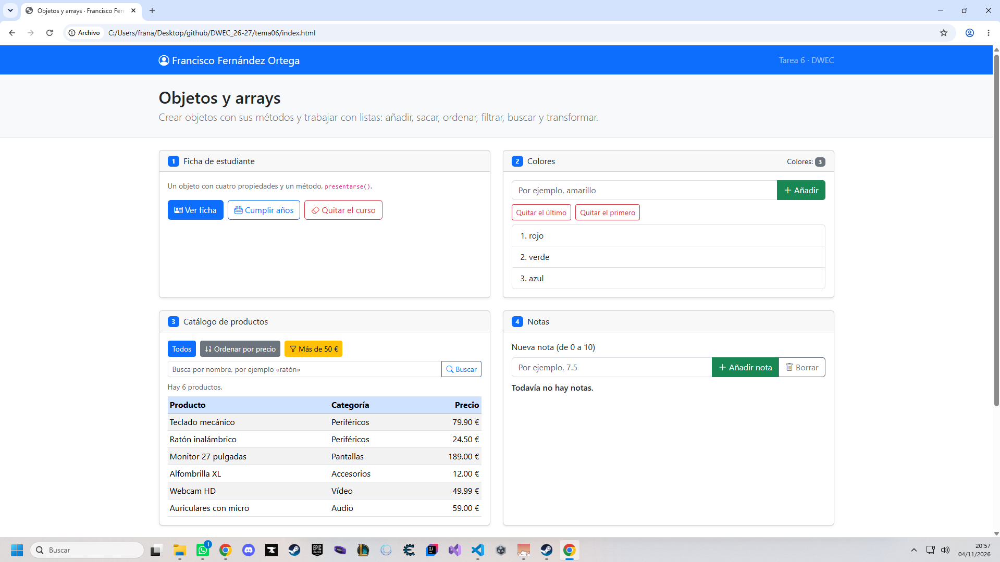
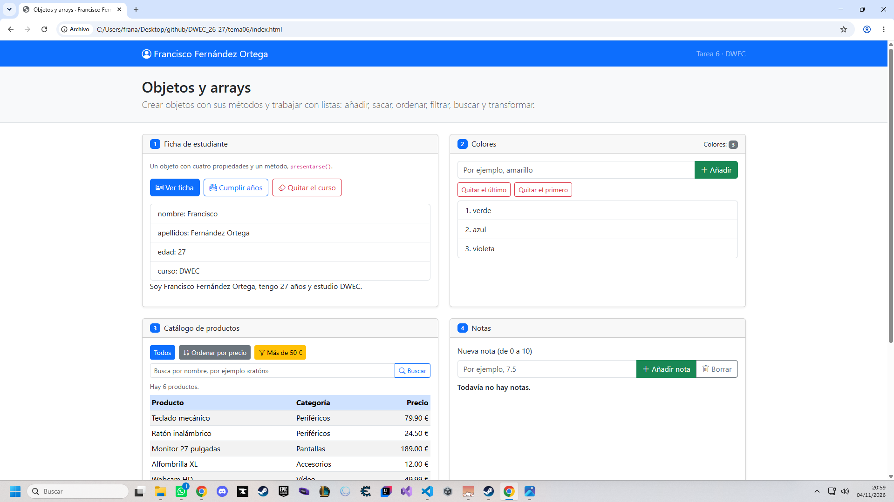
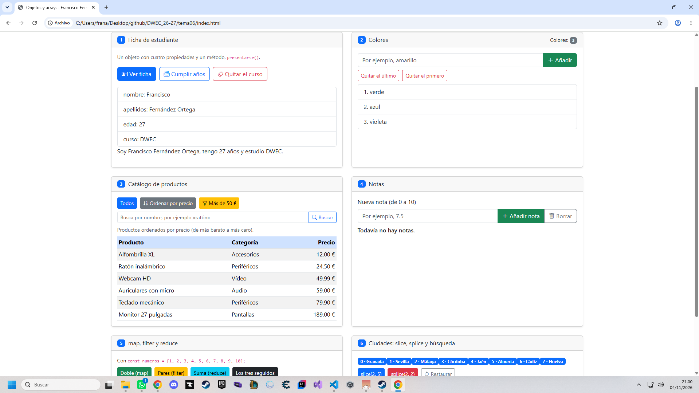
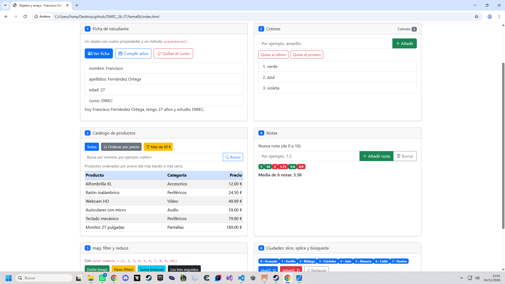
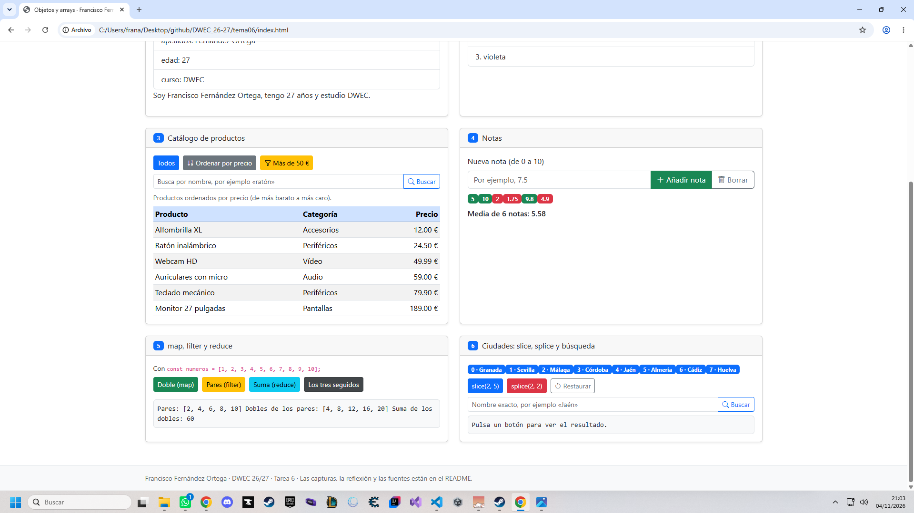
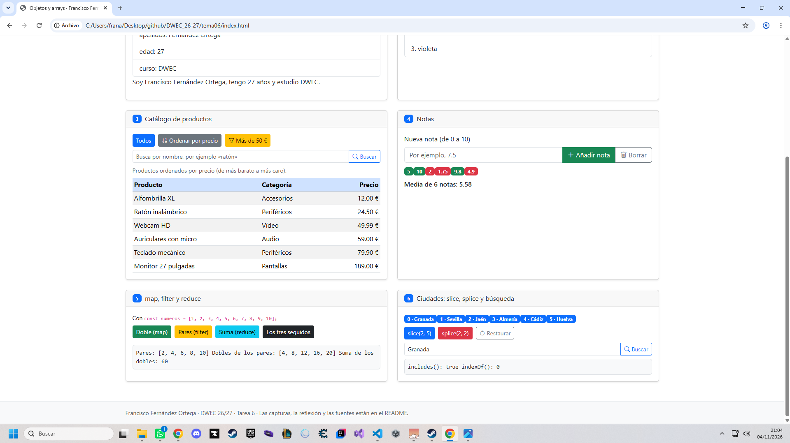

# Tarea 6 · Objetos y arrays

**Autor:** Francisco Fernández Ortega · Desarrollo Web en Entorno Cliente (DWEC) · 2.º DAW · Curso 2026-27

> **Plantilla de la tarea 6.** Cómo usarla:
>
> 1. Copia esta carpeta en tu repositorio de DWEC y cámbiale el nombre a `tema06`.
> 2. `index.html` ya está maquetado: seis tarjetas, una por ejercicio. No cambies los `id` ni el `onclick` de los botones.
> 3. `js/app.js` trae una función por botón con `TODO`. Ya están hechas `comoTexto()`, `pintarProductos()` y casi todo el ejercicio 2: úsalas de modelo.
> 4. Todas las funciones con `function`: en esta tarea, sin funciones flecha.
> 5. Sustituye las imágenes de `capturas/` por las tuyas, **con el mismo nombre**.
> 6. Todo lo que va entre [corchetes] es un hueco: cámbialo por lo tuyo. Al terminar, borra este aviso.

## Capturas

### a) La página recién cargada

En esta captura se muestra la página al cargarla por primera vez. Aparece mi ficha de estudiante, los tres colores iniciales, el catálogo completo de productos y la lista de ciudades.

### b) Ejercicios 1 y 2: la ficha y los colores

En el ejercicio 1 he creado un objeto con mis datos personales y un método presentarse() que muestra una frase con mis datos. También he utilizado delete para eliminar la propiedad curso y he modificado mi edad con el operador ++.

En el ejercicio 2 he utilizado los métodos push(), pop() y shift() para añadir colores, eliminar el último y eliminar el primero de la lista.

### c) Ejercicio 3: el catálogo ordenado por precio

He utilizado sort() con una función de comparación que resta el precio de un producto al del otro. De esta forma, los productos se ordenan de menor a mayor precio.

He realizado una copia del array con el operador spread ([...]) para evitar modificar el array original.

### d) Ejercicio 4: las notas y la media

He creado un objeto alumno que almacena las notas. Utilizo push() para añadir notas y reduce() para calcular la media.

Las notas iguales o superiores a 5 aparecen en verde y las inferiores a 5 en rojo. También he añadido comprobaciones para evitar introducir notas incorrectas.

### e) Ejercicio 5: los tres métodos seguidos

En este ejercicio he utilizado tres métodos consecutivos:

filter(): selecciona los números pares.

map(): calcula el doble de cada número par.

reduce(): suma todos los dobles obtenidos.

El resultado final es 60.

### f) Ejercicio 6: después de splice y de buscar una ciudad

He utilizado splice(2, 2) para eliminar dos ciudades a partir de la posición 2. En este caso, se eliminan Málaga y Córdoba.

Después he utilizado includes() para comprobar si una ciudad está en el array e indexOf() para conocer su posición. Si la ciudad no existe, devuelve -1.

## Reflexión

Durante esta tarea he aprendido a trabajar con objetos y arrays utilizando diferentes métodos de JavaScript. Algunos métodos, como push(), pop(), shift() y splice(), modifican el array original. Otros, como map(), filter() y slice(), devuelven un nuevo resultado sin modificarlo. En el ejercicio 6, slice() permite obtener una parte de las ciudades sin alterar la lista, mientras que splice() elimina elementos directamente. En el ejercicio 3 he utilizado una copia del array antes de ordenarlo con sort(), para conservar los productos originales. Estos métodos permiten trabajar con los datos de forma más sencilla y organizada.

## Fuentes

- [chatGPT](https://chatgpt.com/)
- [w3schools](https://www.w3schools.com/)

## Uso de IA

He utilizado ChatGPT como herramienta de apoyo para comprender los métodos de JavaScript y completar algunas funciones de la tarea. Después he revisado el código, adaptándolo a la plantilla proporcionada y comprobando su funcionamiento en el navegador.
