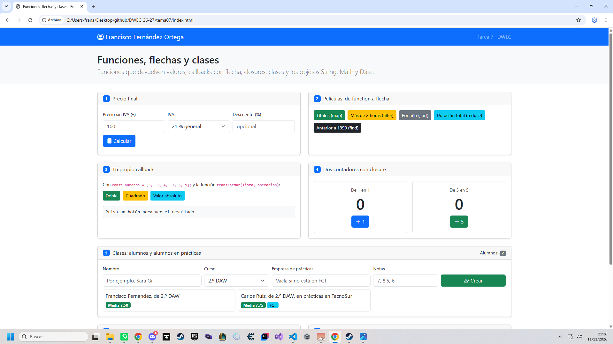
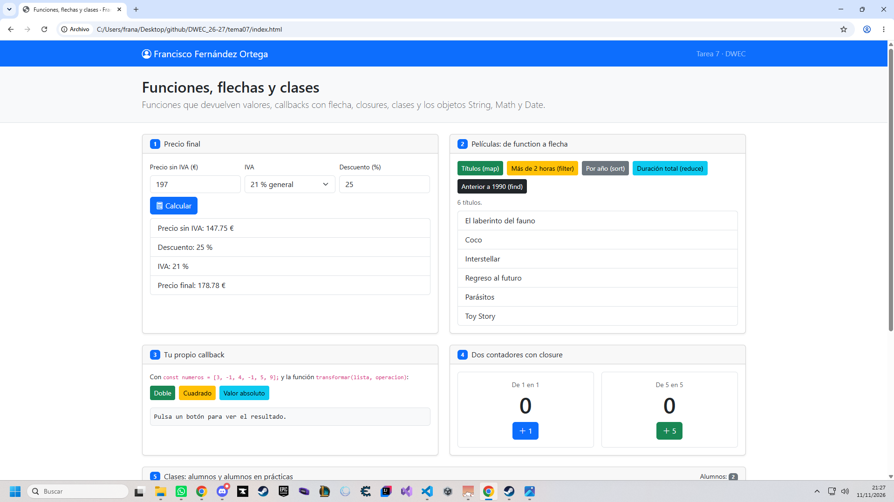
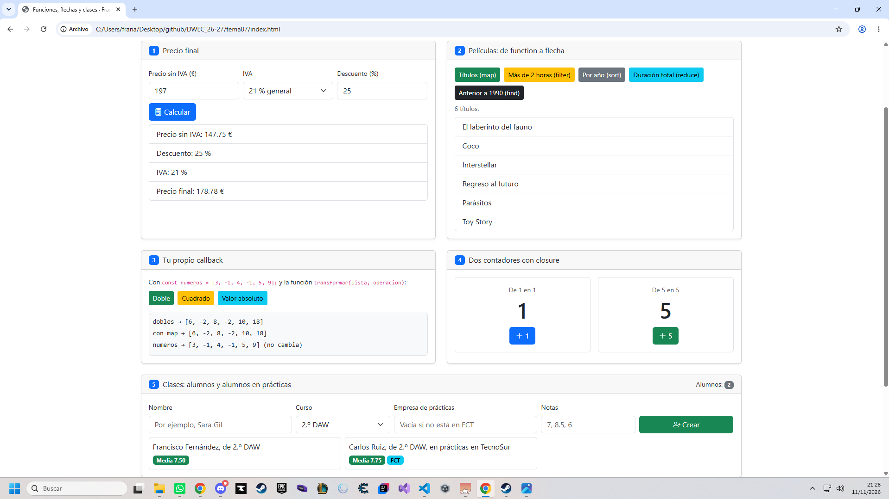
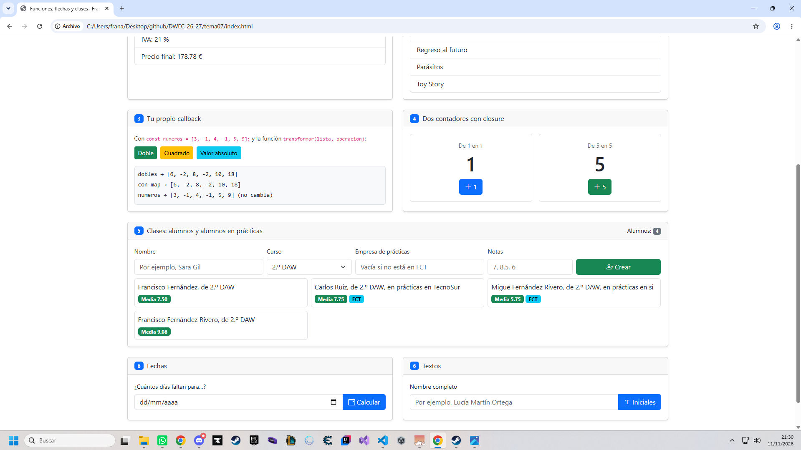
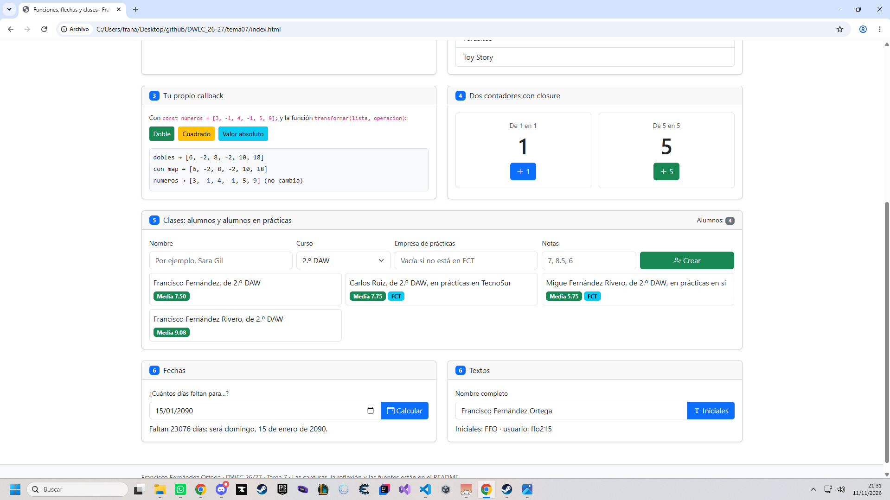

# Tarea 7 · Funciones, flechas y clases

**Autor:** FRANCISCO FERNÁNDEZ ORTEGA · Desarrollo Web en Entorno Cliente (DWEC) · 2.º DAW · Curso 2026-27

> **Plantilla de la tarea 7.** Cómo usarla:
>
> 1. Copia esta carpeta en tu repositorio de DWEC y cámbiale el nombre a `tema07`.
> 2. `index.html` ya está maquetado: una card por ejercicio (el 6 tiene dos). No cambies los `id` ni el `onclick` de los botones.
> 3. `js/app.js` trae una función por botón con `TODO`. Ya están hechas `pintarLista()`, `formatearEuros()`, `pintarAlumnos()` y un modelo en los ejercicios 3, 4 y 6.
> 4. Flechas en todos los callbacks y nunca una flecha como método. Las funciones de los botones, con `function`.
> 5. Sustituye las imágenes de `capturas/` por las tuyas, **con el mismo nombre**.
> 6. Todo lo que va entre [corchetes] es un hueco: cámbialo por lo tuyo. Al terminar, borra este aviso.
## Descripción

En esta carpeta se encuentra la Tarea 7 de DWEC, en la que se trabajan funciones, funciones flecha, callbacks, closures y clases en JavaScript.

La página está organizada en diferentes ejercicios que permiten probar el cálculo de precios, la visualización de películas, la transformación de datos mediante callbacks, los contadores independientes, la creación de alumnos mediante clases y el manejo de fechas y textos.

Para visualizar la página, se debe abrir la carpeta tema07 en Visual Studio Code, iniciar el servidor con Go Live y pulsar los botones de cada ejercicio. Se recomienda tener abierta la consola del navegador (F12) para comprobar los resultados.

## Capturas

### a) La página recién cargada

Al cargar la página se muestra mi nombre en la barra de navegación y los dos alumnos de partida. La página contiene los botones necesarios para ejecutar los distintos ejercicios.

### b) Ejercicios 1 y 2: el precio y las películas

En el ejercicio 1, la función calcularPrecio() calcula el precio final de un producto aplicando el descuento y el IVA. La función mostrarPrecio() muestra el desglose del cálculo.

En el ejercicio 2, se utiliza una función para mostrar una lista de películas, recorriendo los datos y presentándolos en la página.

### c) Ejercicios 3 y 4: tu callback y los contadores

En el ejercicio 3, la función transformar() recibe un callback que se aplica a los datos. De esta forma, se puede reutilizar la función principal con distintas operaciones.

En el ejercicio 4, se crean contadores mediante closures. Cada contador mantiene su propia variable interna, por lo que el contador que aumenta de uno en uno y el que aumenta de cinco en cinco llevan cuentas independientes.

### d) Ejercicio 5: los alumnos

En el ejercicio 5 se utilizan clases para representar a los alumnos. La clase Alumno contiene los datos y métodos comunes, mientras que AlumnoFCT representa a los alumnos que están realizando prácticas y hereda de Alumno.

El código decide qué clase utilizar según si el alumno está en prácticas o no. Se muestran al menos cuatro alumnos en forma de tarjetas.

### e) Ejercicio 6: fechas y textos

En el ejercicio 6 se trabaja con fechas y cadenas de texto. Se calcula el número de días que faltan para la fecha indicada, utilizando el redondeo para obtener un número entero de días. También se obtiene un texto con las iniciales a partir de un nombre.

La fecha probada ha sido [indica la fecha], y el resultado obtenido ha sido [indica cuántos días faltan] días.

## Reflexión

Al pasar un callback de function a una función flecha, cambia la forma de escribirlo y se utiliza una sintaxis más corta. El return sirve para devolver un resultado y poder utilizarlo fuera de la función. Si una función no devuelve nada, su resultado será undefined. Los métodos de las clases no se escriben con funciones flecha porque deben mantener el comportamiento de this asociado al objeto. En mi código, por ejemplo, utilizo callbacks con flechas en el ejercicio de transformación de datos. También uso closures en los contadores para mantener una variable privada. Con esta tarea he aprendido a trabajar con funciones, clases y datos de forma más organizada y reutilizable.

## Fuentes

- [w3schools](https://www.w3schools.com/)
- [chatGPT](https://chatgpt.com/)
## Uso de IA

He utilizado ChatGPT como herramienta de apoyo para comprender algunos conceptos de JavaScript, revisar errores y ayudarme a redactar el README de la tarea. Después he revisado las respuestas, las he adaptado al código de mi proyecto y he comprobado el funcionamiento de los ejercicios en el navegador.
